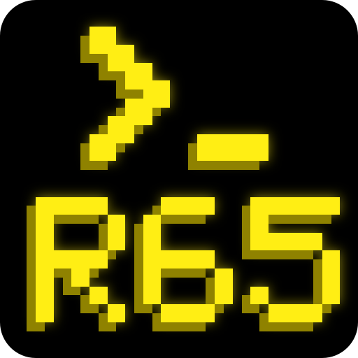

<p align="center">
  
</p>

<h1 align="center">R65</h1>

<p align="center">
  <a href="https://github.com/zstarczali/R65/actions/workflows/build.yml"></a>
  <a href="https://github.com/zstarczali/R65/releases"></a>
  
  <a href="https://github.com/zstarczali/R65/blob/main/LICENSE"></a>
  
  
  
  
  <a href="https://github.com/zstarczali/R65/stargazers"></a>
</p>

A KickAssembler compatible 6502 cross assembler for the Commodore 64, written in
Rust. It assembles KickAss 5.25 sources from the command line and aims to give
the same output bytes, log text and file formats as the original. No Java needed.

## Features

- KickAss language: macros, functions, pseudocommands, structs, scopes, namespaces,
  multi labels, multi-pass label resolving and a script language with lists,
  hashtables, vectors and matrices
- Preprocessor: `#define`, `#if`, `#import` and related directives
- CPUs: 6502 with or without illegal opcodes, C64 DTV and 65C02
- Memory blocks and segments, with `.prg` and raw `.bin` output and `.d64` disk images
- Loading of binary files, SID tunes and gif, jpeg or png pictures
- VICE label files, importable symbol files, byte dumps and memory maps
- An optional editor window

## Building

You need a [Rust toolchain](https://rustup.rs) that supports the 2024 edition.

```bash
cargo build --release
```

The program is written to `target/release/r65` (`r65.exe` on Windows).

On Debian or Ubuntu, first install the window system libraries:

```bash
sudo apt-get install libx11-dev libxkbcommon-dev libwayland-dev libgl1-mesa-dev
```

## Automated builds

GitHub Actions builds `.zip` packages for Windows and `.tar.gz` packages for macOS
and Linux, each for x64 and arm64. Each package holds the program, `README.txt` (usage only),
`LICENSE` and the two PDF manuals from `docs/`. The workflow only runs when started by hand,
from the Actions page or with the command below, and keeps the packages as workflow
artifacts:

```bash
gh workflow run build.yml --ref development
```

A GitHub release is made by the separate `release.yml` workflow, also started by
hand. It checks that the tag matches the version in `Cargo.toml`, builds every
package, then creates the tag on the built commit and publishes the release with
the packages, a `SHA256SUMS` file and generated release notes:

```bash
gh workflow run release.yml --ref main
```

With no `tag` input, the tag is `v` followed by the version in `Cargo.toml`, such as
`v1.0.0`. The `prerelease` and `draft` inputs are optional:

```bash
gh workflow run release.yml --ref main -f prerelease=true -f draft=true
```

## Usage

```bash
r65 game.asm
```

This writes `game.prg` next to the source. The exit code is 0 on success and 1 on
any error.

Some common options:

| Option | What it does |
|---|---|
| `-o <file>` | Name of the output file |
| `-odir <dir>` | Folder for the output files |
| `-showmem` | Print the memory map |
| `-vicesymbols` | Write a VICE label file (`.vs`) |
| `-symbolfile` | Write an importable symbol file (`.sym`) |
| `-bytedump` | Write `ByteDump.txt` with addresses, bytes and source |
| `-define <name>` | Define a preprocessor symbol |
| `-libdir <dir>` | Extra folder to search for imported files |
| `-execute <cmd>` | Run a program with the output file after a successful build |
| `--gui [file]` | Open the editor window |

Default options can be kept in a `r65.cfg` file next to the program.

## Help

The built-in help covers all options and the language:

```bash
r65 --help
```

```bash
r65 --help directives
```

The topics are `options`, `syntax`, `directives`, `preprocessor`, `functions`,
`values`, `segments`, `disk`, `encodings`, `cpu`, `output`, `config`, `examples`,
`limits` and `all`.

## Example

```asm
BasicUpstart2(start)

.const BORDER = $d020

.macro setBorder(color) {
    lda #color
    sta BORDER
}

* = $0810 "Main"
start:
    setBorder(RED)
    rts
```

```bash
r65 border.asm -showmem
```

## Limitations

- Java plugins aren't supported, so `.plugin` and plugin modifiers report an error.
- Progressive or subsampled JPEG pictures may differ slightly from the original.

Run `r65 --help limits` for the current list. The manual lists every known
difference from the Kick Assembler reference manual, in
[section 22](docs/R65-Manual.md#22-limitations).

## Tests

```bash
cargo test
```

The tests run the real program and check exact bytes, log text and exit codes. They
also assemble every example in the manuals and check the opcode tables against them.
The `tests/kickass_gaps.rs` tests describe what the original does and R65 doesn't do yet. They're ignored by
default, and fail when you run them:

```bash
cargo test --test kickass_gaps -- --ignored
```

## Documentation

The [assembly language manual](docs/R65-Manual.md) describes the whole language, and
it's also available [in Hungarian](docs/R65-Manual.hu.md).

## Copyright

(C) 2026 Zsolt Tarczali

## License

MIT — see [LICENSE](LICENSE).
